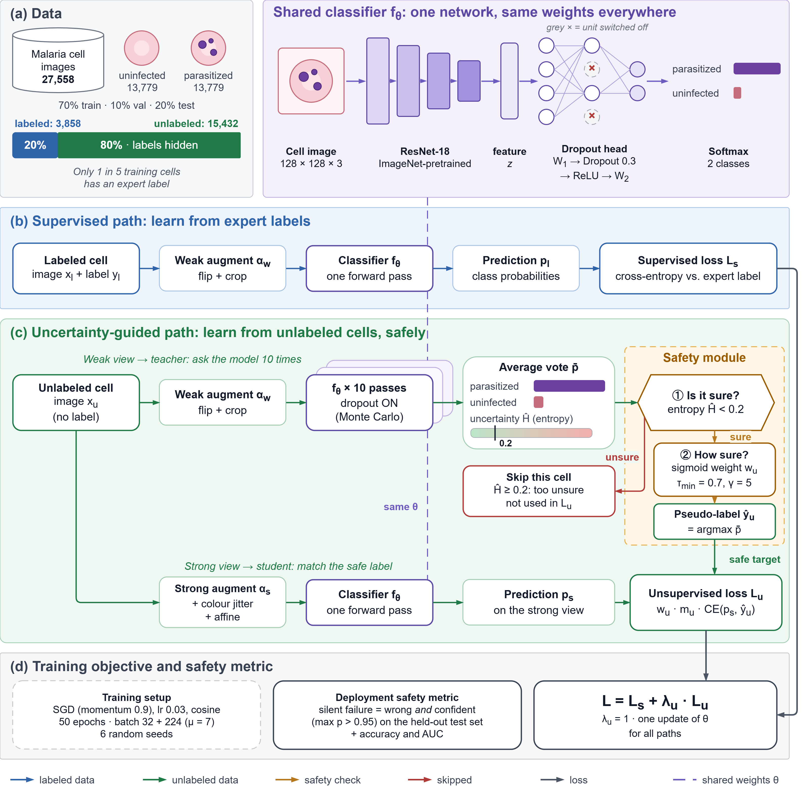

<div align="center">

# Trust, but Verify: Epistemic Uncertainty-Gated Pseudo-Labeling for Safer Semi-Supervised Malaria Screening

**Code and experiment materials accompanying the bioRxiv preprint**

[](https://doi.org/10.64898/2026.10.13.758712)
[](https://pytorch.org/)
[](LICENSE)

[**Read the paper**](https://doi.org/10.64898/2026.10.13.758712) · [**View this repository**](https://github.com/HaloMind-Research/SafeMed-SSL)

</div>

---

## Overview

Medical image annotation takes time, expertise, and resources. Semi-supervised learning (SSL) can reduce the number of labels needed by learning from a small labelled set alongside a larger set of unlabelled images. However, a model can be confidently wrong. When an incorrect prediction is accepted as a pseudo-label, the model may learn from its own mistake.

In **“Trust, but Verify,”** we investigate whether checking epistemic uncertainty before accepting pseudo-labels can reduce these high-confidence errors in malaria cell classification.

Our approach combines **Monte Carlo dropout**, **normalized predictive entropy**, and **confidence-weighted pseudo-labeling**. We evaluate it against a supervised baseline and FixMatch at two confidence thresholds on the public Malaria Cell Images dataset, using only 20% of the training partition's labels.

The main finding: compared with FixMatch at a training confidence threshold of 0.80, the proposed method reduced the mean silent failure rate from **2.28% to 1.52%**—a **33.2% relative reduction**—while maintaining similar accuracy and AUC across six independent runs.

> This is a research preprint and an experimental result on a public dataset. It is not evidence of clinical readiness.

## Paper

**Trust, but Verify: Epistemic Uncertainty-Gated Pseudo-Labeling for Safer Semi-Supervised Malaria Screening**  
Aman Kumar, Ayush Anand, and Latchan Chhetri  
Halo Mind Research Group, India; Sikkim Manipal Institute of Technology, India  
**bioRxiv (2026)** · [https://doi.org/10.64898/2026.10.13.758712](https://doi.org/10.64898/2026.10.13.758712)

All three authors are marked as equal contributors in the preprint. Latchan Chhetri is the corresponding author.

## How the Method Works

The framework combines supervised learning on labelled images with an uncertainty-guided path for unlabelled images.

1. **Generate stochastic predictions.** For each unlabelled image's weakly augmented view, the model runs 10 forward passes with dropout active.
2. **Estimate uncertainty.** We average the stochastic predictions and calculate normalized predictive entropy as an estimate of predictive uncertainty.
3. **Filter uncertain examples.** A pseudo-label is excluded from the unsupervised loss when normalized entropy is **at least 0.2**.
4. **Weight accepted pseudo-labels.** Accepted predictions receive a sigmoid-based confidence weight, with a minimum-confidence parameter of **0.7** and transition parameter **5.0**.
5. **Train using both data sources.** Labelled images contribute a supervised cross-entropy loss. Accepted pseudo-labels contribute an uncertainty-weighted consistency loss on strongly augmented views.

The backbone is an ImageNet-pretrained **ResNet-18**. In this study, the goal is not simply to increase accuracy; it is to reduce confidently incorrect predictions without losing the benefits of learning from unlabelled data.

## Framework Diagram

<div align="center">
  
  <p><em>Figure 1. Overview of the proposed uncertainty-guided semi-supervised learning framework.</em></p>
</div>

## Experimental Setup

| Setting | Details reported in the paper |
|---|---|
| Task | Binary malaria cell classification |
| Dataset | Malaria Cell Images dataset |
| Total images | 27,558 |
| Parasitized / uninfected | 13,779 / 13,779 |
| Input size | 128 × 128 pixels |
| Data split | 70% training, 10% validation, 20% test |
| Labels available during training | 20% of the training partition |
| Unlabelled training data | Remaining 80% of the training partition |
| Backbone | ImageNet-pretrained ResNet-18 |
| Monte Carlo dropout passes | 10 |
| Normalized entropy cutoff | 0.2 |
| Independent runs | 6 random seeds |

The data were randomly split **at the cell-image level**, not at the patient level. This is an important limitation discussed below.

### Training configuration

The paper reports SGD with momentum **0.9**, weight decay **5 × 10⁻⁴**, initial learning rate **0.03** with cosine annealing, and **50 epochs**. The labelled and unlabelled batch sizes are **32** and **224**, respectively. Weak augmentation uses random horizontal flips and crops; strong augmentation additionally uses colour jitter and affine transformations.

The uncertainty-guided configuration uses dropout probability **0.3**, minimum-confidence parameter **0.7**, sigmoid transition parameter **5.0**, normalized entropy cutoff **0.2**, and unsupervised loss weight **1.0**.

## Results

The paper reports mean ± standard deviation over six independent runs with different random seeds.

| Method | Accuracy | AUC | Silent failure rate (SFR) |
|---|---:|---:|---:|
| Supervised baseline (20% labels) | 96.7 ± 0.5% | 0.989 ± 0.004 | 2.01 ± 0.42% |
| FixMatch (training threshold = 0.95) | 96.8 ± 0.4% | 0.992 ± 0.003 | 1.97 ± 0.38% |
| FixMatch (training threshold = 0.80) | 96.4 ± 0.5% | 0.991 ± 0.003 | 2.28 ± 0.47% |
| **Proposed uncertainty-gated method** | **96.6 ± 0.3%** | **0.991 ± 0.002** | **1.52 ± 0.61%** |

### Main result

Against FixMatch trained with the relaxed threshold of 0.80, the proposed method lowered mean SFR from **2.28% to 1.52%**, a **33.2% relative reduction**. The paired t-test across the six runs reported **t = 4.29, p = 0.0078**. The SFR was lower for the proposed method in all six runs.

The SFR evaluation threshold is **0.95**: a silent failure is a wrong prediction made with confidence above 0.95. The statistical significance test reported in the paper is for the comparison against FixMatch with training threshold 0.80. The comparison with FixMatch trained at threshold 0.95 had a lower mean SFR for the proposed method too, but that comparison was not reported as statistically tested.

<div align="center">
  
  <p><em>Figure 2. Silent failure rate at evaluation confidence threshold 0.95 across six random seeds.</em></p>
</div>

## Dataset

The study uses the publicly available [Malaria Cell Images dataset on Kaggle](https://www.kaggle.com/datasets/iarunava/cell-images-for-detecting-malaria), containing 27,558 cell images: 13,779 parasitized and 13,779 uninfected.

The experiment resizes images to 128 × 128 and uses a 70:10:20 random split for training, validation and testing. Only 20% of the training partition's labels are exposed to the learning procedure; the remaining training images are treated as unlabelled.

Please consult the dataset's original publication and terms when using the data in other work.

## Running the Notebook

The repository includes the experiment notebook `FINAL.ipynb` and the figures shown above. To get the repository locally:

```bash
git clone https://github.com/HaloMind-Research/SafeMed-SSL.git
cd SafeMed-SSL
```

Open `FINAL.ipynb` in Jupyter or another compatible notebook environment. Before running it, inspect the notebook for the expected dataset paths and package imports, and configure your local environment accordingly. This README does not assume a separate command-line training script or a pinned dependency file.

## Limitations and Responsible Use

The reported results should be interpreted in light of the study's limitations:

- **Cell-image rather than patient-level splitting.** Cells from the same patient or blood smear may appear in multiple partitions, potentially making absolute performance estimates optimistic. The paper calls for validation using strict patient-level splitting.
- **One dataset and a binary task.** Further evaluation on other datasets, settings and diagnostic tasks is needed.
- **Cropped cell images rather than whole slides.** The study does not validate the method on whole-slide images in a clinical workflow.
- **No external-site validation.** Generalization across laboratories, staining protocols, imaging hardware and populations remains untested.
- **Additional inference cost.** Ten Monte Carlo dropout passes require more computation than a single forward pass.

The results suggest that uncertainty-aware pseudo-label filtering is worth further investigation for semi-supervised medical image classification. They do not establish clinical utility or readiness for deployment. Patient-level and external validation, including whole-slide evaluation, remain necessary.

## Citation

If you refer to this work, please cite the bioRxiv preprint:

```bibtex
@article{Kumar2026.10.13.758712,
  author  = {Kumar, Aman and Anand, Ayush and Chhetri, Latchan},
  title   = {Trust, but Verify: Epistemic Uncertainty-Gated Pseudo-Labeling for Safer Semi-Supervised Malaria Screening},
  journal = {bioRxiv},
  year    = {2026},
  doi     = {10.64898/2026.10.13.758712},
  url     = {https://doi.org/10.64898/2026.10.13.758712}
}
```

### Dataset reference

Rajaraman, S. et al. “Pre-trained convolutional neural networks as feature extractors toward improved malaria parasite detection in thin blood smear images.” *PeerJ* 6:e4568 (2018). [https://doi.org/10.7717/peerj.4568](https://doi.org/10.7717/peerj.4568)

## Acknowledgements

We sincerely thank Dr. Palash Ghosal for his teaching in biomedical image analysis, valuable advice, and insightful discussions that helped shape our understanding and interest in medical imaging.

## License

This repository is distributed under the MIT License. See [LICENSE](LICENSE) for details.
